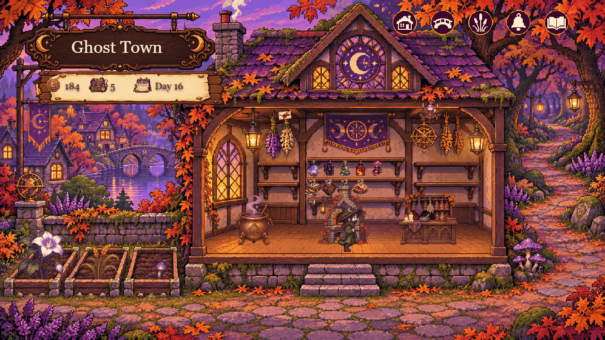
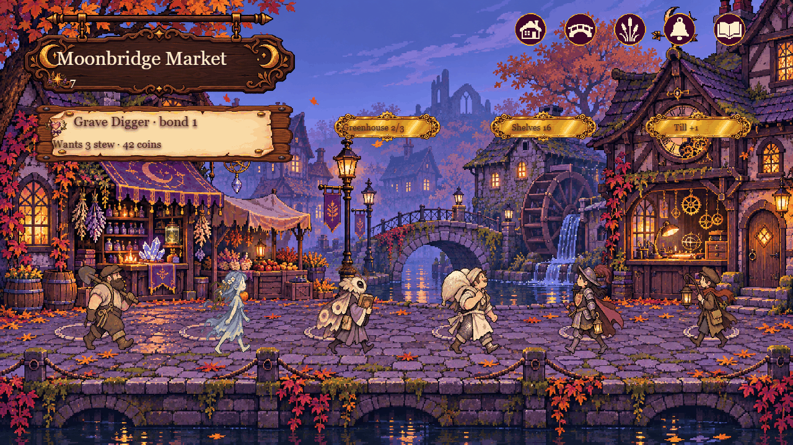
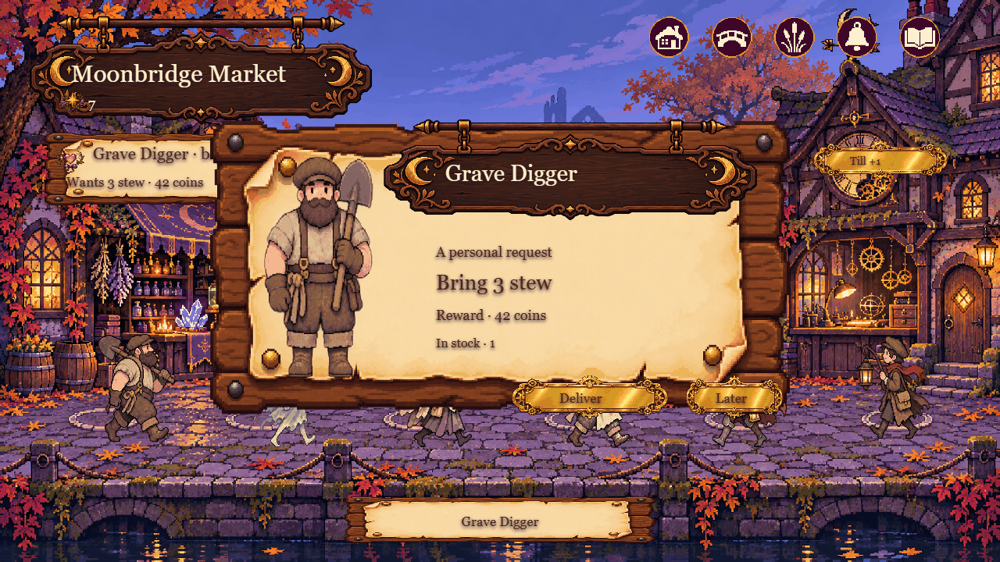
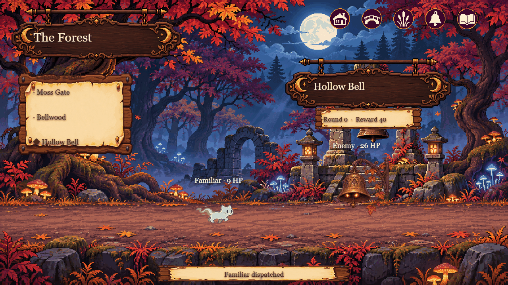
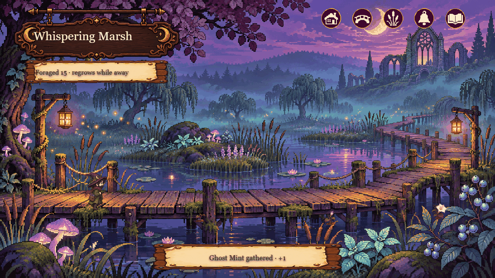
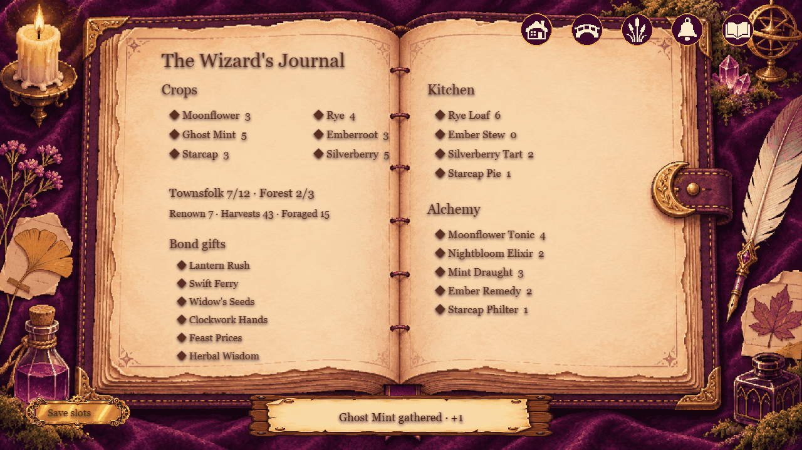
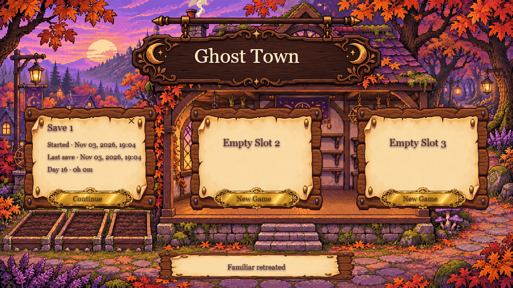
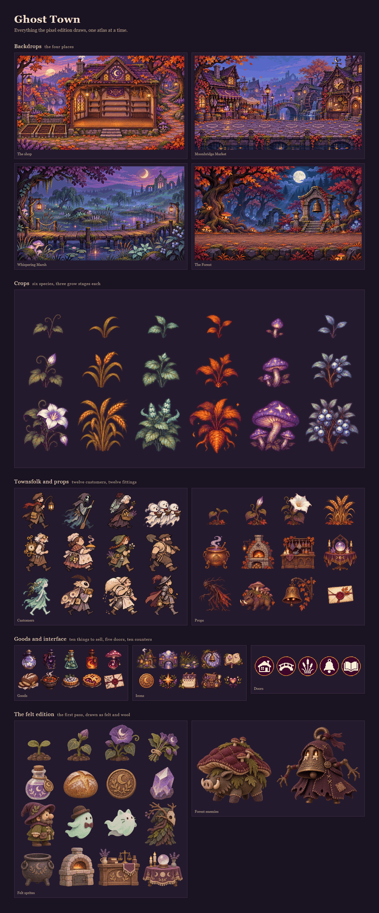
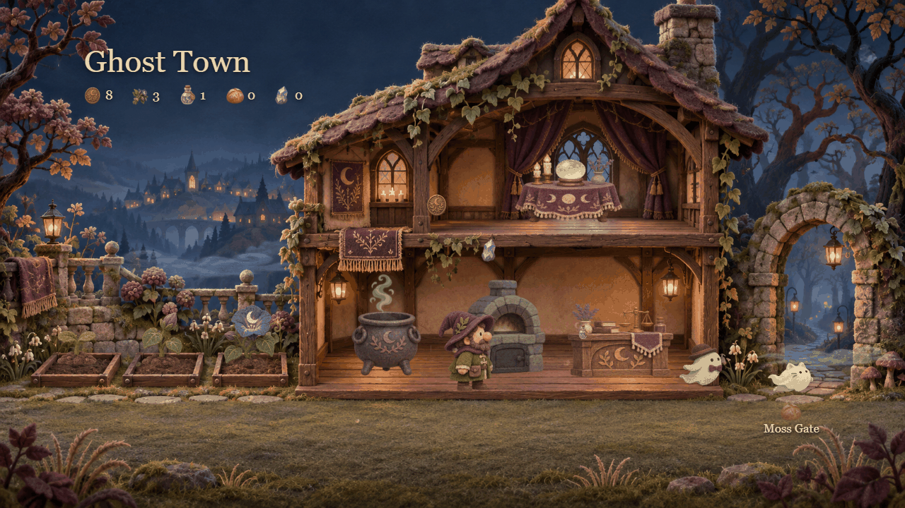

# Ghost Town



**A small idle game about a wizard who keeps a village supplied while the town sleeps.**

You own one cottage shop at the edge of a ghost town. Moonflowers grow in three
beds, the cauldron brews what you tell it to, the oven bakes, the shop door opens
or closes. While you are away the town keeps buying, so the shelves fill and empty
on their own. Your job is to choose what the shop makes, deliver the requests the
townsfolk leave, and send the familiar down the forest trails for crystals.

Everything runs in a browser on one canvas. No build step, no dependencies.

## Play it

```bash
node serve.mjs
# http://127.0.0.1:5174/       the pixel edition
# http://127.0.0.1:5174/felt/  the felt edition
```

Opening `index.html` straight from disk works too. Drawing to a canvas is fine
from `file://`, but save slots are `localStorage`, and a few browsers treat that
origin as temporary, so the server is the safer way to play a long run.

## What you do

- **Sow three beds.** Six species, three grow stages each. Tap a bed to change
  what grows in it.
- **Set the cauldron and the oven.** Each station cycles through its recipes.
  Brewing and baking only consume what you have.
- **Open the shop.** Every sale is worth more as you polish the till.
- **Fill requests.** Townsfolk ask for bread, tonic, herbs, elixir, crystals and
  cooked dishes. Each delivery raises that person's bond, and at bond two they
  give you a perk.
- **Run the trails.** Send the familiar down Moss Gate, Bellwood or the Hollow
  Bell. The third one wards itself, so an elixir pays for itself there.
- **Forage the marsh.** Four nodes regrow over time and keep the rarer
  ingredients coming while you are away.
- **Read the journal.** Crops, bonds, gifts, kitchen and alchemy stock in one
  place.

## The town

| | |
|---|---|
|  |  |
| **Moonbridge Market.** A new request each day, plus shops to upgrade. | **Requests.** The card shows what they want, what it pays and what you hold. |
|  |  |
| **The forest.** Three trails, three creatures, one familiar. | **The marsh.** Forage nodes regrow while the tab is closed. |
|  |  |
| **The journal.** Everything the shop knows about itself. | **Three save slots.** Each one is a separate town, erasable. |

## The art


The whole game is painted first and sliced second. Four backdrops, a six by three
crop sheet, twelve customers, twelve props, ten goods, and the counters and doors
along the top of the screen. Nothing is drawn at runtime except text and a few
sparks, so the atlases below are the game.



The atlases are not uniform grids. The crop sheet, for instance, has three rows of
different heights, so `pixel.js` slices it with measured boxes instead of dividing
by the number of rows.

## Two editions and a prototype

| Folder | What it is |
|---|---|
| `index.html`, `pixel.js`, `art/` | The pixel edition. Six scenes, save slots, bonds, perks, the marsh. |
| `felt/` | The felt edition, the first pass. Felt and wool art, one shop and one forest, a shorter loop. It stays because the two read very differently. |
| `godot/` | The same shop loop in Godot 4, drawn with `_draw()` and one sprite sheet. Open the folder in Godot 4 to run it. |



## How it is built

- One 1280 by 720 canvas, one script per edition, no framework and no bundler.
- State lives in a plain object and is written to `localStorage` every five
  seconds, on `pagehide` and on `visibilitychange`.
- Time away is replayed: up to eight hours of ticks are applied the moment you
  come back, so the shelves, the beds and the familiar all move on.
- Input is a list of rectangles per scene. `pick()` maps the pointer into canvas
  space, so the same coordinates work at any window size.
- The Godot build shares the loop, not the code. It repaints every frame in
  `_draw()` and saves to `user://town.json`.

## Structure

```
index.html          the pixel edition
pixel.js            all of its logic and drawing
art/                the pixel atlases
felt/               the felt edition, self contained
felt/index.html
felt/town.js
godot/              the Godot 4 prototype
docs/screens/       the screenshots in this file
docs/art/           the atlas sheet
serve.mjs           a 60 line static server, no dependencies
```

## Licence

The code in `pixel.js`, `town.js`, `town.gd` and `serve.mjs` is MIT, see
[LICENSE](LICENSE). The artwork in `art/`, `felt/`, `godot/sprites.png` and
`ghost-icon.png` is not covered by that grant and stays with the author.
